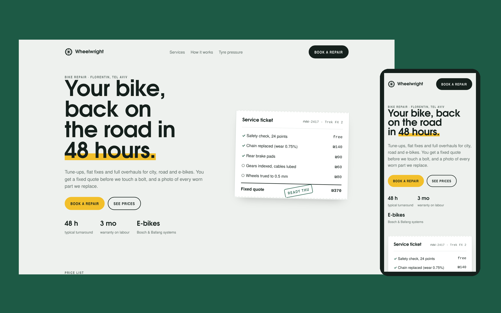

# Wheelwright Bike Works — landing page

Concept landing page for a local bike repair workshop. The goal of the page is simple: turn a visitor into a booked repair.

## What's inside

- Hero with a "service ticket" that shows how a fixed quote looks
- Price list for six common repairs with turnaround times
- 4-step "how it works" section
- Tyre pressure reference table (PSI and bar by bike type)
- Booking form with validation and a drop-off date picker that skips Saturdays
- Responsive from wide desktop down to 390px phones
- Light and dark theme that follows the system setting
- Fonts embedded in the page, no external requests, no frameworks

## Tech

Plain HTML, CSS and vanilla JavaScript in a single `index.html`. Open it in a browser, nothing to install.

The same layout can be rebuilt on WordPress or Tilda for a real business.

Design and code by Mark Taran · [Upwork profile](https://www.upwork.com/freelancers/~01fdcade25dbc8df29)
